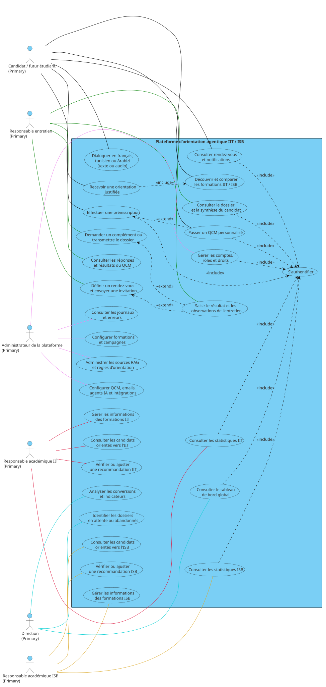

# Diagramme des cas d’usage

## Vue d’ensemble

Le diagramme reprend les cinq acteurs métier définis dans le document officiel du projet. Le système agentique et ses agents sont des composants internes, pas des rôles humains.

## Cas d’usage principaux

### 1. Candidat / futur étudiant
- Échanger avec la plateforme en français, dialecte tunisien ou Arabizi, par texte ou audio.
- Découvrir et comparer les formations de l’IIT et de l’ISB, puis recevoir des recommandations expliquées.
- Construire progressivement son profil, effectuer une préinscription et passer un QCM ciblé.
- Consulter son rendez-vous et recevoir les notifications de suivi.

Le candidat peut commencer une conversation sans compte. Cette possibilité est un mode d’accès, pas un acteur métier distinct dans le document officiel. La création de compte et les informations requises interviennent avant les actions de préinscription qui les nécessitent.

### 2. Responsable académique IIT
- Consulter les candidats orientés vers l’IIT, leur profil, leurs recommandations et les résultats du QCM.
- Vérifier ou ajuster une recommandation et gérer les informations des formations IIT.
- Consulter les statistiques d’intérêt et d’orientation vers les parcours IIT.

### 3. Responsable académique ISB
- Consulter les candidats orientés vers l’ISB, leur profil, leurs recommandations et les résultats du QCM.
- Vérifier ou ajuster une recommandation et gérer les informations des formations ISB.
- Consulter les statistiques d’intérêt et d’orientation vers les formations ISB.

### 4. Responsable entretien
- Consulter les candidats prêts pour un entretien, leur profil, leur parcours conversationnel et la formation recommandée.
- Consulter le QCM, ses réponses et la synthèse des points à approfondir.
- Définir ou valider un rendez-vous, envoyer une invitation et saisir le résultat de l’entretien.
- Demander un complément ou transmettre le dossier à l’étape suivante.

### 5. Direction
- Suivre les volumes de conversations, orientations, préinscriptions, entretiens et inscriptions.
- Analyser les formations demandées, les orientations IIT/ISB et les taux de conversion.
- Identifier les dossiers en attente ou abandonnés et consulter les indicateurs du système agentique.

### 6. Administrateur de la plateforme
- Gérer les comptes, rôles, droits, formations, campagnes et paramètres du workflow.
- Administrer les sources documentaires RAG, les règles d’orientation, les modèles de QCM et les notifications.
- Superviser les agents IA, les intégrations, les paramètres techniques, les journaux et les erreurs.

## Composants internes (non-acteurs)

Le superviseur agentique, le LLM, le RAG, la transcription audio et les outils de notification sont des composants du système. Ils assistent les acteurs, mais ne remplacent pas les responsables humains pour la validation des recommandations, les entretiens ou les décisions officielles.

## Règles métier dérivées

- Un candidat peut démarrer une conversation sans compte; les données personnelles ne sont conservées et rattachées qu’en respectant les règles de consentement et de sécurité.
- Un candidat ne peut accéder qu’à son propre profil, ses réponses et son dossier.
- Les responsables académiques consultent les candidats et les données de formation dans leur périmètre IIT ou ISB.
- Le responsable entretien accède aux dossiers prêts pour entretien et saisit les résultats et observations associés.
- La Direction consulte des indicateurs de pilotage; l’accès aux données individuelles doit être limité au besoin métier.
- L’administrateur configure la plateforme, mais les validations académiques et les décisions officielles restent humaines.
- Les actions sensibles et les changements de statut sont traçables.

## Livrable attendu

Ce document permet de formaliser les interactions fonctionnelles avant la conception technique et le développement.
