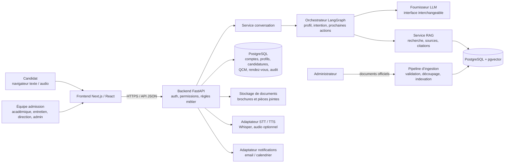
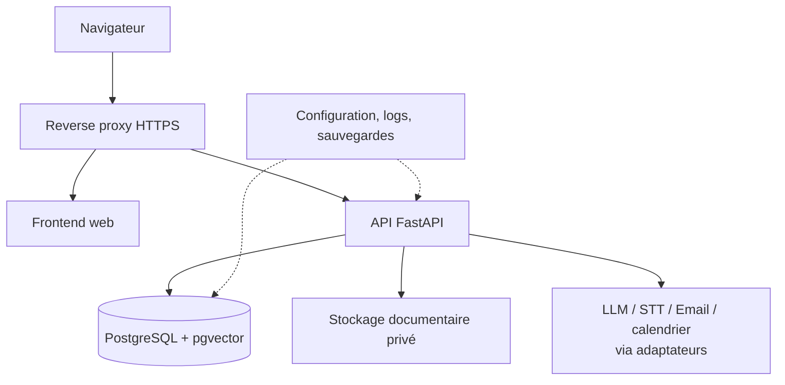

# SA-4 - Architecture technique du système

## 1. Objectif et périmètre

Ce document définit l’architecture de référence de SmartCampus AI pour le sprint 1. Elle couvre le chat candidat, les espaces internes, les services métier, la conversation agentique, le RAG, la persistance et les intégrations externes. Elle complète les acteurs et processus de [SA-3](01-cas-utilisation.md) et prépare la conception des API et des droits de [SA-5](05-api-et-regles-acces.md).

L’architecture est conçue pour un prototype évolutif : un déploiement simple au départ, des responsabilités séparées dans le code, et la possibilité d’extraire des composants en services indépendants si la charge ou les besoins d’exploitation le justifient.

## 2. Principes d’architecture

- Les décisions officielles d’admission et la validation académique restent humaines.
- Le backend est l’autorité pour les règles métier, les permissions et les changements d’état; le frontend et les agents IA ne les contournent pas.
- Les sources officielles IIT/ISB sont la référence des réponses sur les formations. Le RAG fournit des extraits et leurs références, pas une décision d’admission.
- Une conversation anonyme est isolée par session et n’est rattachée à un compte qu’après authentification et consentement explicite.
- Les composants IA et les intégrations externes sont appelés derrière des interfaces dédiées pour pouvoir changer de modèle ou de fournisseur.
- Les échanges importants et les changements de statut sont journalisés sans enregistrer inutilement des données sensibles ou des secrets.

## 3. Architecture logique

Le stockage relationnel et l’index vectoriel peuvent partager PostgreSQL avec pgvector au démarrage. Les documents originaux sont conservés dans un stockage de fichiers; leurs métadonnées, versions, droits et références sont enregistrés en base.

## 4. Composants et responsabilités

| Composant | Responsabilités principales | Choix de référence |
|---|---|---|
| Interface web | Chat texte/audio, parcours candidat, tableaux de bord par rôle, administration | Next.js et React |
| API et services métier | Authentification, contrôle d’accès, profils, candidatures, QCM, rendez-vous, statuts, audit | FastAPI (Python) |
| Service conversationnel | Gestion du contexte et des sessions, appel de l’orchestrateur, filtrage et présentation des réponses | Module backend, API interne typée |
| Orchestrateur agentique | Détection d’intention, extraction progressive du profil, choix de l’action suivante et appel contrôlé aux outils | LangGraph, sans accès direct à la base métier |
| Service RAG | Recherche dans les sources publiées, filtrage IIT/ISB, renvoi des passages et références | PostgreSQL + pgvector; embeddings configurables |
| Base relationnelle | Comptes, rôles, programmes, sessions, consentements, candidatures, QCM, rendez-vous et journal d’audit | PostgreSQL |
| Ingestion documentaire | Import, validation, versionnage, découpage et indexation des documents autorisés | Tâche backend contrôlée par l’administration |
| Audio et notifications | Transcription et, si nécessaire, synthèse vocale; envoi d’emails et gestion de calendrier | Adaptateurs vers Whisper et fournisseurs externes |

FastAPI est retenu plutôt que NestJS afin de garder l’API, l’orchestration LangGraph et les outils IA dans le même écosystème Python pendant le prototype. Le frontend reste séparé. Le backend commence comme un monolithe modulaire; les services du schéma sont des frontières logiques, pas des microservices à déployer séparément dès le sprint 1.

## 5. Flux principaux

### Conversation et orientation

1. Le navigateur envoie un message et l’identifiant de session au backend via HTTPS.
2. Le backend vérifie la session, applique les limites d’usage, puis transmet le message au service conversationnel.
3. L’orchestrateur détermine s’il doit demander une précision, consulter le RAG ou proposer une prochaine action. Les outils disponibles sont explicitement autorisés et validés par le backend.
4. Pour une question sur les formations, le RAG récupère uniquement des passages issus de documents publiés pour le périmètre concerné. La réponse présente les sources utilisées; en l’absence de source suffisante, le système le signale et propose une vérification humaine.
5. Le backend conserve l’état utile à la conversation selon la politique de conservation et renvoie la réponse au navigateur.

### Audio

Le navigateur transmet l’audio au backend par un endpoint dédié. Le backend vérifie le format et la taille, appelle l’adaptateur STT, puis traite le texte transcrit comme un message normal. La réponse audio est optionnelle; elle passe par un adaptateur TTS sans modifier les règles métier.

### Préinscription et suivi

Le backend exige un compte authentifié et les consentements requis avant de rattacher une session ou de créer une candidature. Il valide les données, persiste chaque transition de statut et déclenche les notifications autorisées. Les décisions ou validations académiques sont enregistrées comme des actions d’un utilisateur habilité, jamais comme une décision autonome du LLM.

### Administration du RAG

Un administrateur autorisé dépose ou met à jour un document. Le pipeline conserve sa provenance, son établissement, sa version et son statut de publication. Seuls les documents validés sont indexés pour les réponses candidates; un retrait ou une nouvelle version invalide les passages correspondants.

## 6. Sécurité et données

- Toutes les communications navigateur-API utilisent HTTPS en environnement déployé.
- Les routes internes exigent une authentification; les permissions sont contrôlées côté backend à chaque requête et chaque objet métier.
- Les rôles académiques sont limités à leur périmètre IIT ou ISB. Le responsable entretien ne voit que les dossiers préparés pour entretien. La Direction privilégie les indicateurs agrégés.
- Les sessions anonymes utilisent un identifiant difficile à deviner, une durée de vie limitée et des quotas. Elles n’exposent aucune donnée d’une autre session.
- Les secrets (clés de modèle, SMTP, base) sont fournis par configuration d’environnement et ne sont ni versionnés ni envoyés au navigateur.
- Les entrées utilisateur et les fichiers sont validés; les instructions contenues dans les documents RAG sont traitées comme des données, pas comme des instructions système.
- Les données personnelles, transcriptions et traces sont minimisées. Les durées de conservation, l’effacement et la gestion du consentement devront être confirmés selon les exigences du projet et le cadre applicable.
- Les journaux d’audit enregistrent l’acteur, l’action, la date et l’objet concerné; ils évitent les secrets et le contenu complet des conversations lorsque celui-ci n’est pas nécessaire.
- Les réponses générées restent des propositions explicables. Les actions à effet métier sont vérifiées par le backend et, lorsque requis, confirmées par un humain.

L’authentification, le format des jetons, les endpoints et la matrice détaillée des permissions sont définis dans [SA-5](05-api-et-regles-acces.md) et les travaux SA-27/SA-28; ce document fixe les frontières sans préempter ces contrats.

## 7. Déploiement cible du prototype

En développement, l’application peut être lancée avec trois services conteneurisés : frontend, backend et PostgreSQL avec pgvector. Les appels au LLM, au STT et à l’email passent par des variables de configuration et peuvent être désactivés ou remplacés par des adaptateurs de test. Les migrations de schéma sont exécutées de façon contrôlée; les données de démonstration sont séparées des données réelles.

En environnement déployé, le frontend et l’API sont exposés derrière un reverse proxy HTTPS. La base et le stockage documentaire ne sont pas accessibles directement depuis le navigateur. Les sauvegardes, la supervision, les limites de coût des appels IA et la gestion des données personnelles sont configurées avant tout usage avec de vrais candidats.

## 8. Décisions et points à valider

| Sujet | Décision proposée | À confirmer |
|---|---|---|
| Backend | FastAPI et Python pour rapprocher API et composants agentiques | Compétences et choix finaux de l’équipe |
| Frontend | Next.js / React | Bibliothèque UI et stratégie de déploiement |
| Données | PostgreSQL avec extension pgvector pour réduire le nombre de services | Disponibilité de pgvector sur l’environnement cible |
| Orchestration | LangGraph derrière le service conversationnel | Modèle LLM et fournisseur après évaluation SA-31 à SA-34 |
| Documents | Stockage privé séparé des métadonnées et embeddings | Fournisseur ou solution locale et règles de conservation |
| Voix | Whisper via adaptateur; sortie audio facultative | Exécution locale ou service externe, coût et confidentialité |
| Notifications | Adaptateur email, calendrier ultérieur | Fournisseur disponible et autorisations d’envoi |
| Exécution locale | Conteneurs pour frontend, backend et base | Outil de conteneurisation disponible dans l’équipe |

## 9. Évolution par étapes

1. **Socle sprint 1 :** valider les choix, définir les frontières des modules, le modèle de déploiement et les responsabilités de sécurité.
2. **Socle fonctionnel :** construire l’API, l’authentification, le catalogue, les sessions de conversation et le schéma relationnel.
3. **Conversation augmentée :** brancher le RAG sur des sources validées, ajouter l’évaluation des réponses et intégrer le modèle retenu.
4. **Parcours complet :** ajouter préinscription, QCM, rendez-vous, notifications et écrans des rôles internes.
5. **Préparation à l’usage réel :** tester les permissions, la qualité multilingue, la robustesse, les sauvegardes, les coûts et la conservation des données.

## 10. Critères d’acceptation SA-4

- Les composants, leurs responsabilités et leurs communications sont décrits et représentés dans un diagramme.
- Les flux conversation, RAG, audio, préinscription et administration documentaire sont cohérents avec les cas d’utilisation.
- Les données métier restent sous le contrôle du backend; l’accès est cloisonné par rôle et périmètre.
- Les interactions IA sont remplaçables, les sources RAG sont traçables et les décisions officielles restent humaines.
- Les choix proposés, leurs raisons et les décisions restant à confirmer sont documentés.
- L’architecture peut être réalisée progressivement sans imposer une infrastructure microservices prématurée.