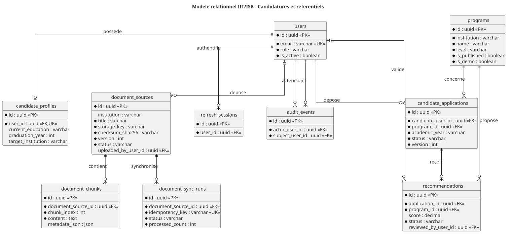

# SA-10 à SA-18 - Modèle relationnel et référentiels

## Périmètre livré

Le schéma SQLAlchemy du backend réutilise la table `users` de SA-27/SA-28. Il ajoute les profils candidats, le catalogue IIT/ISB, les candidatures et recommandations, les sources documentaires, les segments de texte et l’historique de synchronisation.



[Source PlantUML du modèle relationnel](diagrams/modele-relationnel.puml)

## Règles d’intégrité

- Les rôles d’authentification existants restent attachés à `users`; aucun second référentiel de comptes n’est créé.
- Un profil candidat est unique par compte. Une candidature référence un compte candidat et une formation existante.
- Les formations et documents distinguent `IIT` et `ISB`; les statuts et niveaux sont contraints par la base.
- Les recommandations sont rattachées à une candidature et une formation; un score, s’il existe, doit rester entre 0 et 1. La validation humaine est conservée séparément de la recommandation proposée.
- Les sources documentaires gardent leur provenance, version, checksum et état de publication. Les chunks et synchronisations dépendent de la source.
- Les formations de démonstration portent `is_demo=true` et `is_published=false`; elles ne sont jamais destinées aux réponses candidates ni à l’index RAG public.
- Les fichiers originaux ne sont pas stockés dans PostgreSQL : `storage_key` référence un stockage privé. Les embeddings vectoriels sont laissés à l’intégration RAG ultérieure; PostgreSQL est préparé avec pgvector.

## Migrations et données de démonstration

Les migrations Alembic sont dans `backend/migrations`. Pour initialiser le schéma :

```powershell
cd backend
docker compose up -d db
python -m alembic upgrade head
python -m app.seed_demo
```

Le seed peut être relancé sans doublonner les formations. Il n’insère ni compte administrateur ni mot de passe de démonstration. Les intitulés de démonstration sont fictifs et non publiés jusqu’à leur remplacement par des données validées par l’IIT et l’ISB.